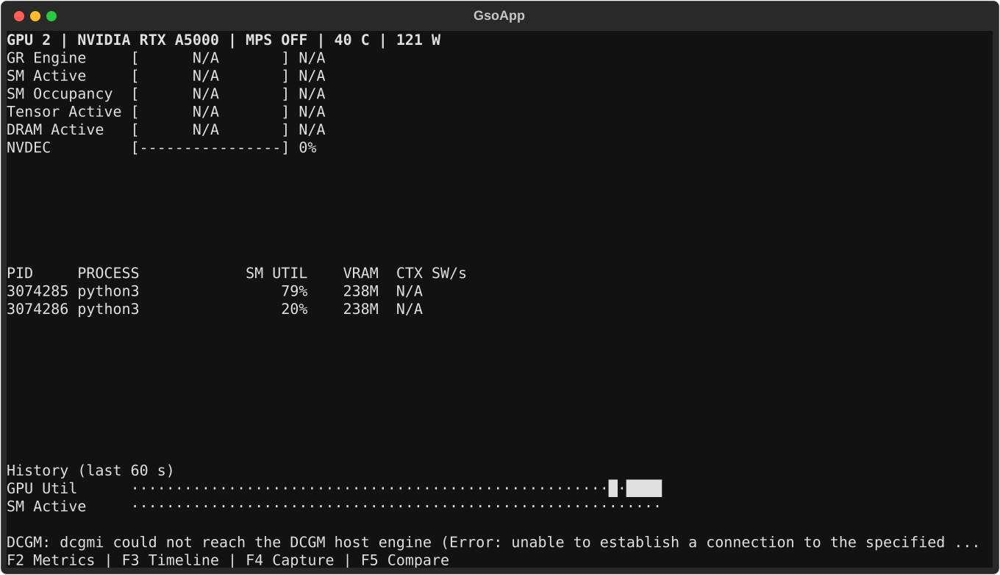
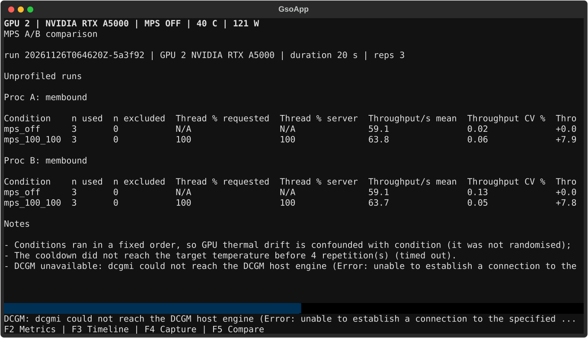
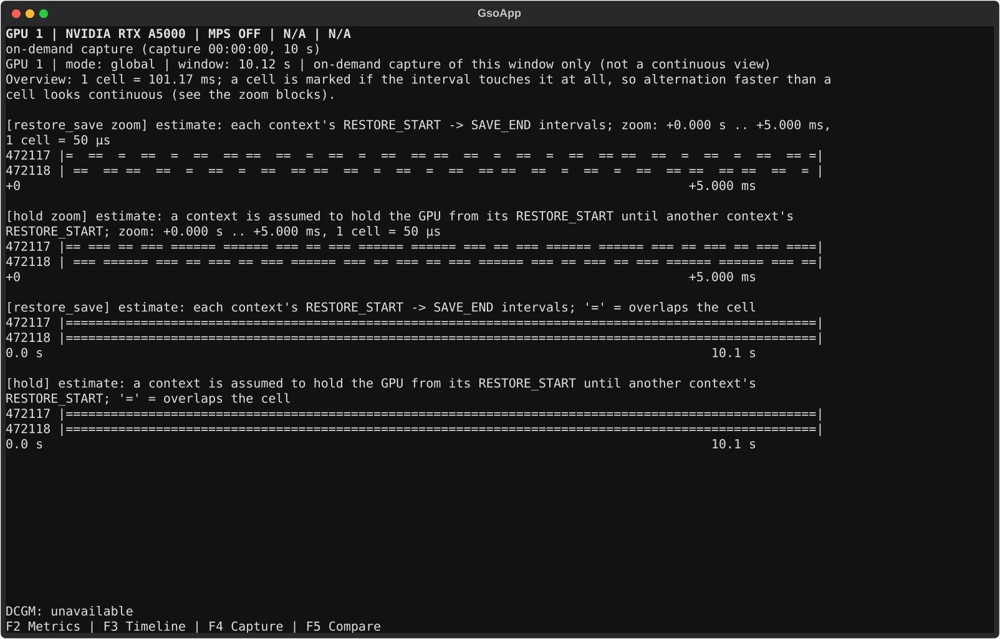

# gpu-sched-observatory
See who actually runs on your GPU, and when. A TUI for context switching, kernel overlap, and CUDA MPS impact.

`gso` is a Python tool for NVIDIA GPUs that sit between `nvtop`-style monitors and a full
Nsight Systems session. It answers questions that GPU utilisation alone cannot:

- Which resource inside the GPU is saturating (SM, Tensor pipes, DRAM)?
- Which processes take turns on the GPU, and how often does the context change?
- What does CUDA MPS change for throughput and tail latency, measured as an A/B run?

It is an MVP. Read [Limitations](#limitations) before trusting any number: several metrics
are estimates and the tool says so on screen.

## What it shows

| Command | What you get |
|---|---|
| `gso doctor` | What can be measured on this machine: GPUs, driver, MIG, DCGM, nsys, root, MPS. |
| `gso live` | A terminal screen for one GPU: DCGM bars (GR Engine, SM Active, SM Occupancy, Tensor Active, DRAM Active), NVDEC, temperature and power, a per-process table, 60 s history. `F2` metrics, `F3` timeline, `F4` capture, `F5` compare. |
| `gso capture` | One on-demand Nsight Systems capture (5 to 10 s). Writes a JSON summary and a text timeline of context intervals. |
| `gso bench` | An MPS A/B benchmark of two workloads on one GPU under five MPS conditions. |
| `gso compare` | A comparison report (terminal and optional markdown) of a `gso bench` run. |

### Screens

Live view of GPU 2 while two small-kernel processes ran on it. DCGM was unreachable on this
host, so the DCGM bars show `N/A` rather than a made-up zero:



F5 compare view, loaded with `--bench-dir` from a real two-process memory-bound run
(n=3 repetitions; see the caveats in the example below):



F3 timeline, from a stored 10 s global capture of two contending processes on GPU 1. It
shows the same intervals under both context-interval constructions (`restore_save` and
`hold`), which are estimates and differ from each other. The header row shows `N/A` because
this screenshot was rendered from the stored capture without live collection:



## Requirements

- Linux x86_64, an NVIDIA GPU, and an NVIDIA driver (NVML is used through `nvidia-ml-py`).
  Verified with driver 580.126.20.
- Python 3.10 or newer. Developed and tested with Python 3.12.
- [`uv`](https://docs.astral.sh/uv/) is used in the examples below.
- Optional, each unlocks more:
  - **DCGM** (`dcgmi` and a running host engine, for example the NVIDIA DCGM container) for
    SM Active, SM Occupancy, Tensor Active and DRAM Active. Without it those rows are `N/A`
    and everything else still works. Use `--dcgmi-cmd "docker exec <container> dcgmi"` and
    `--dcgm-gpu-index` when DCGM runs in a container (inside the container the GPU index can
    differ from the host's).
  - **Nsight Systems (`nsys`)** for `gso capture`, the live capture key, and profiled bench
    runs. Verified with 2026.6.1.
  - **CUDA MPS** (`nvidia-cuda-mps-control`) for `gso bench`.
  - The `bench` dependency group (PyTorch, TensorRT, ONNX, ...) for the benchmark workloads.

### Root and non-root

gso never calls `sudo`. Everything was verified without root. In that mode:

- nsys global capture works and decodes PIDs for your own processes.
- **Other users' processes appear as one masked context without a PID.** Timestamp
  precision for them may also be lower.
- What a root capture would show instead was **not** verified. The related verdicts in
  [`docs/verification/RESULTS.md`](docs/verification/RESULTS.md) (G2 and G4) are marked
  provisional for that reason. If you capture as root yourself, expect differences and
  treat the masking notes in the output as not applicable.

## Install

```bash
git clone https://github.com/KangHongJun/gpu-sched-observatory
cd gpu-sched-observatory
uv sync                       # live, capture, compare, doctor
uv sync --group bench         # additionally, the benchmark workloads
uv run gso --help
```

For development: `uv sync --group dev && uv run pytest -q`.

## Usage

Every command that touches a GPU (`live`, `capture`, `bench`) requires `--gpu`. There is no
default GPU, so you never touch a GPU by accident on a shared machine. `doctor` and
`compare` take no `--gpu`.

### `gso doctor`

```bash
uv run gso doctor
uv run gso doctor --dcgmi-cmd "docker exec gso-dcgm dcgmi" --dcgm-gpu-index 0
```

Lists the GPUs with driver and MIG state and reports whether DCGM, nsys, root and MPS are
available, with the reason when something is not.

### `gso live`

```bash
uv run gso live --gpu 0
uv run gso live --gpu 0 --interval 1.0 --dcgm-interval-ms 100
uv run gso live --gpu 0 --bench-dir results/run1      # enables the F5 Compare view
uv run gso live --gpu 0 --headless --duration 60 --export metrics.jsonl
```

- `--interval` is the refresh period (default 1 s, at least 0.1). `--dcgm-interval-ms`
  is the DCGM sampling period (default 1000, at least 100). 100 ms sampling is an option;
  in one test it stayed within run-to-run variation (see [Overhead](#overhead)).
- `--export PATH` writes metric records as `.jsonl` or `.csv`. In the interactive screen the
  file is written when you quit and holds the last 5 minutes at most. With `--headless`
  it is streamed for the whole run.
- `--headless --duration SECONDS` runs without the screen. Exit codes: 0 records written,
  1 nothing written, 2 usage error, 3 write error (data kept in `PATH.partial`), 130
  interrupted.
- On an MPS GPU the CTX SW/s column reads `N/A (MPS)` (see Limitations).

### `gso capture`

```bash
# global capture: context switches of every process, report covers --gpu only
uv run gso capture --gpu 0 --out out/cap1 --duration 10

# launched capture: the command runs under nsys and its kernel intervals are captured
uv run gso capture --gpu 0 --out out/cap2 -- python my_workload.py
```

Runs **one on-demand capture** of 5 to 10 s (default 10). It is not continuous monitoring.
Writes `summary.json`, `timeline.txt` and `capture.sqlite` (and `capture.nsys-rep` with
`--keep-rep`). `--end-target` ends the launched command when the capture ends. Exit codes:
0 done, 2 usage error, 3 write error, 4 nsys not available, 5 capture failed, 130
interrupted.

### `gso bench`

```bash
uv run gso bench --gpu 2 --a small_kernels --b small_kernels --out out/bench1
uv run gso bench --gpu 2 --a decode --b fp16_matmul --out out/bench2 \
    --conditions mps_off mps_100_100 --duration 20 --warmup 5
```

Runs workloads A and B together on one GPU under `mps_off`, `mps_100_100`, `mps_50_50`,
`mps_70_30` and `mps_30_70` (or the subset given by `--conditions`). Workloads:
`small_kernels`, `membound`, `fp16_matmul`, `trt_infer` (only with the tensorrt package), `decode`. Per condition: one
untimed warm-up and at least three measured repetitions (`--reps`, default 3). Results go
to `OUT/results.jsonl` and `OUT/run.json`. `--profile` adds one on-demand nsys capture per
repetition; profiled and unprofiled rows must not be compared.

Safety behaviour:

- The MPS daemon is user-scoped, started per MPS condition and stopped afterwards.
- A safety check runs before each repetition. It fails if the GPU has a
  compute process (plain or MPS) that this run did not start, if any MPS control daemon or
  server exists on the machine that this run did not start, or if safety cannot be
  established (for example NVML cannot list the processes). A failing check is retried for
  5 s, because this run's own MPS server may still be exiting; if it keeps failing, the run
  aborts.
- During each repetition the GPU is sampled once per second, and the check runs again right
  after it. If a foreign process was seen in either, the repetition's rows are written but
  marked unfair and excluded from the statistics, and the run aborts (exit code 3).
- No `sudo`, no clock locking. The GPU is cooled down between repetitions (at most 60 s).

Exit codes: 0 complete, 1 incomplete (failed repetitions), 2 usage error, 3 aborted for
safety, 4 internal error, 130 interrupted.

### `gso compare`

```bash
uv run gso compare out/bench1
uv run gso compare out/bench1 --md out/bench1/report.md
```

Reads `results.jsonl` (and `run.json`) and prints the report. Only repetitions that are ok
and fair enter the statistics; excluded ones are counted. Unknown values are `N/A`. The
same report is shown in the F5 view of `gso live --bench-dir`.

## Example results

One small run, to show what the report looks like and not to benchmark anything:
two `small_kernels` processes on one RTX A5000, 30 s per repetition, n=3 repetitions per
condition, mean throughput in iterations per second.

| Condition | A requested % | A | B requested % | B |
|---|---|---|---|---|
| mps_off | N/A | 6131 | N/A | 6113 |
| mps_100_100 | 100 | 49607 | 100 | 48336 |
| mps_50_50 | 50 | 48717 | 50 | 48452 |
| mps_70_30 | 70 | 48224 | 30 | 37078 |
| mps_30_70 | 30 | 37535 | 70 | 50538 |

Read it with these caveats:

- The server-side thread percentage stayed 100 in every condition; the table shows
  what was **requested** per client. `CUDA_MPS_ACTIVE_THREAD_PERCENTAGE` is an upper bound,
  not a guaranteed share.
- Conditions ran in a fixed order, so GPU temperature drift (start temperature 47 to 57 C
  across conditions) is confounded with the condition.
- Three repetitions only. These are two tiny-kernel processes on one shared machine; MPS
  helped a lot here, but in a separate run of a TensorRT plus small-kernel pair at 50/50
  the TensorRT process got about 31% slower. Do not generalise.
- DCGM was unavailable on this host, so no SM, Tensor or DRAM columns.

More runs, including a memory-bound pair (+8% with MPS), a profiled run, and a run that
was aborted on purpose when a foreign process appeared on the GPU, are summarised in
[`docs/verification/RESULTS.md`](docs/verification/RESULTS.md) (Task 24 and Task 25;
written in Korean).

## Overhead

Measured once: two small-kernel processes on one GPU, n=3 repetitions per condition, 30 s
each.

| Collector | Change in total throughput |
|---|---|
| DCGM sampling at 100 ms | +0.12%, inside run-to-run variation (the baseline varied by 0.46%) |
| nsys global capture, 10 s inside the 30 s run | -6.94% averaged over 30 s (the drop inside the 10 s window is larger and was not measured separately) |

One workload, one GPU, three repetitions: do not generalise. nsys capture is on-demand for
this reason. It is not an always-on collector.

## Verified environment

- GPU: NVIDIA RTX A5000
- Driver: 580.126.20
- OS: Linux x86_64
- Nsight Systems: 2026.6.1
- Python: 3.12 (the project requires 3.10 or newer)
- All measurements came from **one shared multi-GPU machine**, without root, with
  MPS off except where a benchmark condition turned it on for its own user-scoped daemon.

Other GPUs, drivers, nsys versions, MIG, vGPU, and Jetson were not tested.

## Limitations

Full list: [`docs/limitations.md`](docs/limitations.md). The short version:

- Unsupported or unknown metrics show `N/A`, never `0`.
- nsys is **on-demand capture** of 5 to 10 s, not a continuous view.
- Context time outside a context's interval is **not** switching overhead.
- Both context-interval constructions (`restore_save` and `hold`) are **estimates** and
  they disagree. gso shows both and does not merge them.
- Kernel-interval overlap is **not** SM-level concurrency.
- Device counters cannot be split by PID. Per-PID attribution is an estimate.
- Tensor Active is pipe activity, not FLOPS.
- On MPS GPUs context-switch events were not recorded, so CTX SW/s is `N/A (MPS)`.
- `CUDA_MPS_ACTIVE_THREAD_PERCENTAGE` is an upper bound. gso reports "requested" and
  "server" values and never claims a limit was "applied".
- Without root, other users' processes are masked; root behaviour is unverified
  (provisional).

## Not implemented yet

- Jetson backend and `tegrastats`.
- A CUPTI real-time collector and CUPTI PM sampling. CUPTI launch injection was tried in a
  spike; attaching to an already running process and per-PID switch records were not
  confirmed.
- Kernel queue delay (submission to start). The nsys export does not contain submission
  times. An API-call-to-kernel-start estimate is provided instead.
- Kernel overlap between independent processes in a single capture.
- Fixed request-rate workloads. Benchmark workloads are closed-loop (maximum speed).
- GPU clock locking (needs privileges).
- Multi-GPU views, a Prometheus exporter, automatic bottleneck detection.

## Repository notes

- Design spec: `docs/specs/` (Korean). Verification notes and gate results:
  `docs/verification/` (Korean; `nsys-schema.md` documents the nsys SQLite export
  schema that the loader reads).
- Comparison with other GPU monitors was not re-verified and is intentionally left out.

## License

Apache License 2.0. See [`LICENSE`](LICENSE).
