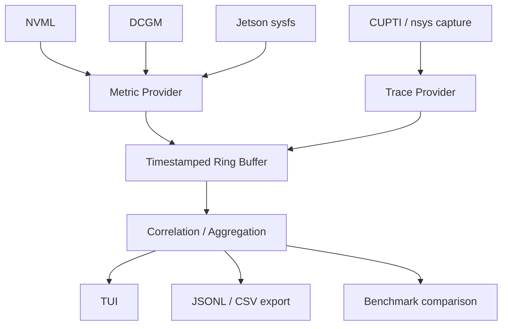

# GPU Scheduling Observatory

nvtop과 Nsight Systems 사이의 경량 실시간 GPU 스케줄링 프로파일러

작성일: 2026-11-25 | 상태: 기획 및 기술 검증 단계

## 1. 배경과 목표

다중 프로세스가 GPU를 공유하는 영상 분석 및 TensorRT 추론 환경에서 GPU 사용률만으로는 자원 경합, Context Switching, 커널 실행 지연을 설명하기 어렵다. GPU 전체 사용률뿐 아니라 SM, Tensor Core, 메모리, Context별 실행 상태를 터미널에서 관찰하고 CUDA MPS 적용 효과를 정량화하는 도구를 개발한다.

핵심 질문:

- GPU 내부에서 어떤 자원이 포화되는가?
- 어떤 PID/Context가 언제 실행되는가? 전환 빈도는 얼마인가?
- 여러 프로세스의 커널이 실제로 중첩 실행되는가?
- MPS 적용 후 throughput, tail latency, occupancy가 개선되는가?

## 2. 유사 프로젝트와 차별점

| 프로젝트 | 주요 역할 | 차별화 후보 |
|---|---|---|
| nvtop | GPU 및 프로세스 TUI | Context timeline, MPS 비교 |
| nvitop | NVIDIA GPU 프로세스 관리 및 모니터링 | 세부 하드웨어 카운터와 스케줄링 분석 |
| KempnerPulse | DCGM 기반 세부 GPU 지표 TUI | 프로세스 실행 경합 및 MPS 비교 |
| nv-toplike | 세부 GPU 지표 시각화 후보 | 실제 측정 방식과 지원 범위 검증 필요 |
| dgxtop | GPU 및 프로세스 모니터링 후보 | Context 및 커널 실행 분석 |
| Nsight Systems | 정밀 타임라인 분석 | 상시 TUI 및 빠른 비교 워크플로 |

경쟁 프로젝트의 최신 소스코드와 실제 동작은 이번 문서에서 재검증하지 않았다. 기능 부재를 확정하거나 사용자 수요를 입증한 것은 아니다.

## 3. 지원 대상

- 초기: Linux x86_64, RTX A5000, NVIDIA CUDA 환경.
- 확장: GeForce, 데이터센터 GPU, Jetson Orin NX 16GB.
- GPU, 드라이버, CUDA, JetPack 버전별 capability detection 필수.
- 미지원 지표는 0 대신 N/A로 표시한다.

## 4. 수집 백엔드

| 백엔드 | 용도 | 한계 |
|---|---|---|
| NVML | GPU/PID 사용률, VRAM, 전력, 온도, NVENC/NVDEC, MPS 프로세스 | PID별 세부 하드웨어 카운터 제한 |
| DCGM | 장치 단위 SM/Tensor/DRAM 카운터 | GPU별 지원 차이, 카운터 충돌, 구간 평균 |
| CUPTI Activity | CUDA 커널, 스트림, Context, API 이벤트 | 삽입/attach 범위 및 버전 검증 필요 |
| CUPTI PM Sampling | 고해상도 성능 카운터 | 카운터 조합, 권한, 장치 지원 제약 |
| Nsight Systems | 기준 타임라인, 전역 Context Switch 캡처 | 보고서 중심이며 실시간 스트리밍 인터페이스는 별도 검증 |
| tegrastats/sysfs | Jetson GPU/EMC 및 시스템 상태 | 세부 카운터 대체 불가 |

### DCGM 기본 카운터

| Field ID | 지표 |
|---|---|
| 1001 | GR Engine Active |
| 1002 | SM Active |
| 1003 | SM Occupancy |
| 1004 | Tensor Active |
| 1005 | DRAM Active |

Tensor Active는 연산 파이프 활동 지표이지 달성 FLOPS나 물리 Tensor Core 점유 개수와 동일하지 않다. SM Active도 실제 명령 발행률과 다르다. DRAM Active만으로 대역폭 포화를 단정하지 않는다.

## 5. Context Switching 분석

CUPTI 13.2.1 문서에 다음 이벤트가 명시되어 있다.

- `CUPTI_ACTIVITY_KIND_COMPUTE_ENGINE_CTX_SWITCH`
- `CUpti_ActivityComputeEngineCtxSwitch`
- `CUpti_ActivityContext`의 contextId/processId로 연결

MIG, vGPU, QNX에서는 해당 CUPTI 이벤트가 지원되지 않는다. 독립 collector에서 이미 실행 중인 외부 프로세스 전체의 이벤트를 실시간으로 얻을 수 있는지는 핵심 검증 과제다.

Nsight Systems의 `--gpuctxsw`는 root 권한에서 모든 프로세스의 PID/Context ID를 포함한 전환 기록을 수집할 수 있다. 일반 사용자도 다른 사용자 이벤트를 관찰할 수 있으나 ID가 마스킹되고 타임스탬프 정밀도가 낮아진다.

### 파생 지표

| 지표 | 정의 |
|---|---|
| Context Switch Rate | 관찰 구간 내 실제 Context 전환 수 / 초 |
| Context Residency | 관찰 구간 대비 해당 Context 활성 구간의 합집합 비율 |
| Context Slice Duration | 연속 활성 구간 길이 분포 |
| Kernel Queue Delay | 동일 시간 기준의 커널 제출~실행 시작 간격 |
| Kernel Duration | 실행 시작~종료, P50/P95/P99 |
| Inter-process Overlap | 서로 다른 PID의 커널 실행 구간이 중첩된 시간 / 전체 관찰 시간 |
| Dropped Events | 수집 중 유실된 이벤트 수 |

Context 비활성 시간 전체를 전환 오버헤드로 취급하지 않는다. 커널 구간 중첩은 실제 SM 단위 동시 실행량과 동일하지 않다. 장치 전체 카운터를 PID별로 정확히 분해할 수 있다고 가정하지 않는다.

## 6. MPS Analyzer

MPS 사용 시 서로 다른 프로세스의 커널이 함께 실행될 기회가 생긴다. 단, 메모리/연산 자원 경합으로 latency가 악화될 수도 있다.

`CUDA_MPS_ACTIVE_THREAD_PERCENTAGE`는 실행 자원 상한이며 독점적인 물리 SM 분할이나 보장된 처리량이 아니다. 일반적인 환경 변수 설정은 클라이언트 시작 전에 적용한다.

```bash
echo 'get_server_list' | nvidia-cuda-mps-control
echo 'get_client_list <SERVER_PID>' | nvidia-cuda-mps-control
echo 'get_active_thread_percentage <SERVER_PID>' | nvidia-cuda-mps-control
```

NVML의 `nvmlDeviceGetMPSComputeRunningProcesses`도 검토한다. 서버 설정과 클라이언트별 실제 적용 제한은 구분해서 기록한다.

### A/B 실험

| 조건 | A | B |
|---|---|---|
| MPS OFF | 기본 | 기본 |
| MPS ON | 100% | 100% |
| MPS ON | 50% | 50% |
| MPS ON | 70% | 30% |
| MPS ON | 30% | 70% |

- Workload: 작은 compute kernel, TensorRT 추론, memory-bound kernel, 실제 Decoder/Inference 조합.
- 동일 입력, 배치, 요청률, GPU 클럭/전력 조건 및 측정 시간을 유지한다.
- 워밍업 후 각 조건을 최소 3회 반복한다. 프로파일러 미사용 기준도 수집한다.
- 프로세스별 FPS/throughput, P50/P95/P99 latency, SM/Tensor/DRAM, Context Switch Rate, overlap, 전력, 프레임 누락을 기록한다.
- 설정별 결과를 비교하고 성능 개선율과 변동성을 보고한다.
- 운영 중인 MPS 서버나 생산 워크로드를 자동 변경하지 않는다.

## 7. 아키텍처



추천 스택: C++17/20 + FTXUI + CMake. 빠른 검증은 Python으로 시작해도 된다. 수집과 렌더링 스레드를 분리하고 bounded buffer를 사용한다.

공통 레코드에는 timestamp, GPU UUID, PID, context ID, stream ID, metric name, value, unit, source, scope, quality를 둔다. 측정값/추정값/미지원/유실을 구분하고 PID 재사용 및 컨테이너 PID namespace도 고려한다.

### 운영 모드

1. Live: NVML/DCGM 기반 경량 모니터링. 기본 갱신 1초, 지원 시 100ms 수집.
2. Capture: 5~10초 nsys 또는 CUPTI 정밀 캡처. 카운터 소유권 충돌 관리.
3. Compare: baseline과 MPS 실험 결과 비교.

## 8. TUI 구상

```
GPU 0 | RTX A5000 | MPS ON | 64 C | 178 W
SM Active     [############----] 78%
SM Occupancy  [#######---------] 42%
Tensor Active [#####-----------] 32%
DRAM Active   [###########-----] 67%
NVDEC         [#############---] 84%

PID    PROCESS       SM UTIL   VRAM   CTX SW/s
1420   decoder            8%   2.4G        120
1421   detector          62%   8.2G        135
1422   embedding         21%   4.1G         80

Context / Kernel timeline (recent window)
1421   ====    ====      ======
1422     ===      ====      ===

F2 Metrics | F3 Timeline | F4 Capture | F5 Compare
```

위 수치는 가상 데이터다. MPS 환경에서 Context 전환이 보이지 않으면 N/A로 표시하고 커널 overlap 및 애플리케이션 성능을 우선한다.

## 9. 기술 검증 체크리스트 (UI 개발 전)

```bash
nvidia-smi
nvidia-smi pmon -s um
# DCGM 설치 및 지원 확인
dcgmi profile -l -i 0
dcgmi dmon -i 0 -e 1001,1002,1003,1004,1005 -d 100
# nsys 옵션은 설치 버전의 help로 확인
nsys profile --help
sudo nsys profile --gpuctxsw=true --duration=10 -o ctx_baseline
nsys export --type=sqlite ctx_baseline.nsys-rep
ncu --query-metrics
# Jetson
tegrastats
```

- [ ] A5000에서 DCGM 필드별 지원 여부 확인
- [ ] nsys 전역 Context Switch 수집 및 PID 매핑 확인
- [ ] SQLite export 스키마를 실제 보고서에서 확인
- [ ] CUPTI standalone/late attach/launch injection 범위 확인
- [ ] MPS OFF/ON에서 Context 및 커널 이벤트 수집 차이 확인
- [ ] Collector의 수집 지연, 유실률 및 워크로드 오버헤드 측정
- [ ] Jetson에서 지원되는 metric 및 권한 확인

DCGM과 개발 프로파일러의 카운터 충돌 시 `dcgmi profile --pause` / `--resume`을 검토한다. 최신 문서 기준 host engine 전체에 영향을 주므로 공유 서버에서는 임의 실행하지 않는다.

## 10. 주요 한계와 대응

- 전역 하드웨어 카운터는 PID를 직접 포함하지 않는다. 시간 상관관계 기반 귀속은 추정으로 표시한다.
- 동시 실행하는 PID별 Tensor/DRAM 기여율의 정확한 분해는 MVP에서 제외한다.
- Nsight Compute의 PM Sampling용 Context Switch Trace는 다중 MPS 클라이언트 및 모바일 플랫폼 등에서 지원되지 않는다. 다른 추적 API까지 동일한 제약이라고 일반화하지 않는다.
- nsys 보고서 캡처를 즉시 실시간 스트리밍이라고 표현하지 않는다. 자체 collector 검증 실패 시 짧은 on-demand capture를 대안으로 사용한다.
- 지원 카운터 조합, 권한, 버전별 API 호환성을 기능 감지하고 노출한다.
- 커널 추적 및 profiling overhead를 별도로 측정한다.

## 11. 한 달 MVP 로드맵

| 주차 | 목표 | 완료 조건 |
|---|---|---|
| 1 | 기술 검증 | A5000 카운터, nsys 전역 Context 캡처, 2-process 재현 |
| 2 | Live TUI | NVML/DCGM 지표, PID 표, history, N/A 처리 |
| 3 | Scheduling Capture | Context timeline, switch rate, 보고서 export |
| 4 | MPS 비교 | 5개 설정 benchmark, 결과 리포트, README 및 공개 준비 |

MVP 이후: CUPTI 실시간 collector, Jetson backend, 자동 병목 후보 탐지, 멀티 GPU, Prometheus exporter, workload-aware GPU scheduler.

성공 기준: 기존 GPU 모니터보다 빠르게 실제 경합 현상을 발견하고, nsys 기준 데이터와 모순되지 않는 실행 타임라인을 제공하며, MPS 전후 성능 차이를 반복 가능한 방식으로 보여준다. GitHub 공개 후에는 사용자 피드백과 실제 사용 사례로 수요를 검증한다.

## 12. 공식 참고 문서

- NVIDIA DCGM Profiling
- DCGM Profiling API
- CUPTI 13.2.1 Usage — Compute Engine Context Switch
- Nsight Systems User Guide
- Nsight Compute Profiling Guide
- CUDA MPS Documentation
- NVML API

DCGM, CUPTI, Nsight 관련 주요 제약은 2026-11-25 공식 문서로 재확인했다. 실제 장치에서 명령 실행이나 성능 실험은 수행하지 않았으며, 경쟁 프로젝트 최신 기능 및 MPS/NVML 세부 API는 추가 검증이 필요하다.
